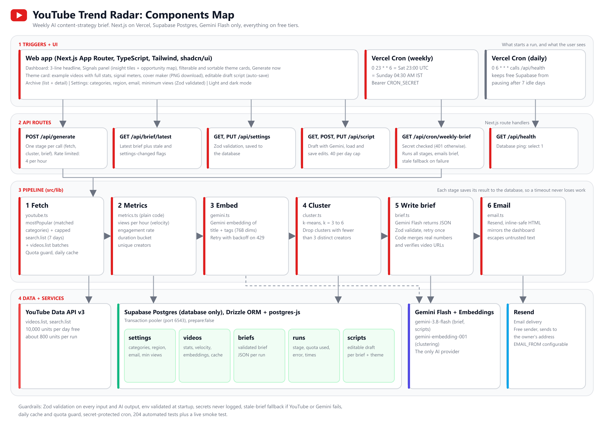
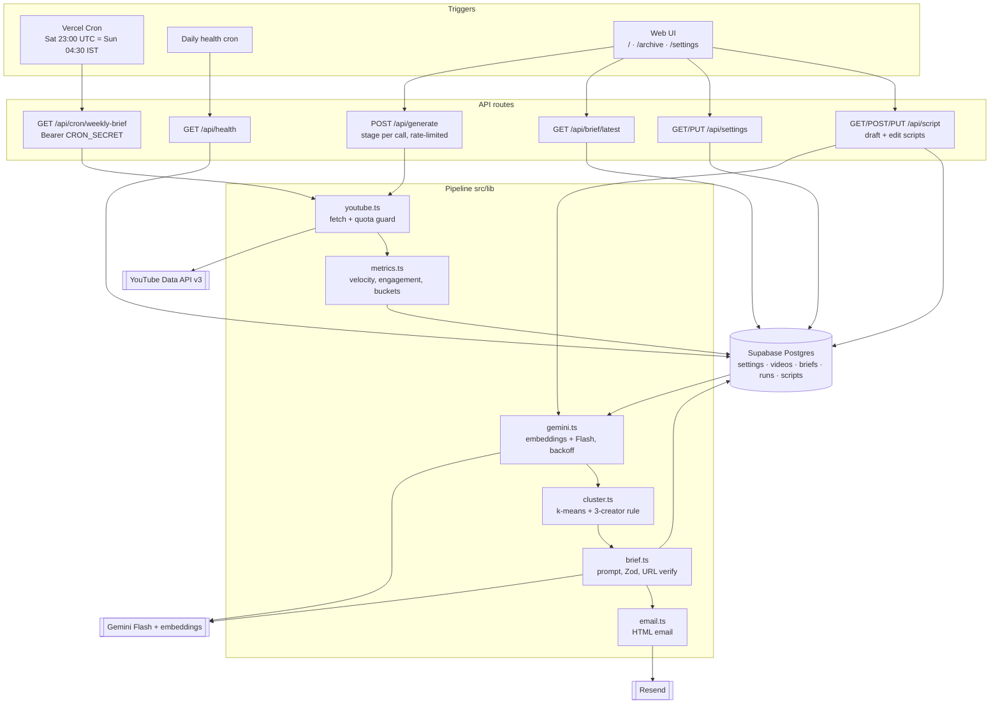

# YouTube Trend Radar

An AI-powered **weekly Sunday content strategy brief** for a tech YouTuber (AI tools, productivity apps, tech reviews). It does not list videos. It finds **patterns**: 3-5 theme clusters that multiple creators are covering this week, which formats are winning, typical length, and a filming recommendation with urgency.

- Generated and emailed every **Sunday ~04:30 AM IST** (Vercel Cron, Saturday 23:00 UTC).
- Categories, region and recipient are configurable in `/settings`.
- All AI uses **Gemini Flash only** (plus Gemini embeddings). No Anthropic/Claude API.
- Everything runs on free tiers: Vercel Hobby, Supabase, YouTube Data API, Gemini, Resend.

## How it works

1. **Fetch**: `videos.list?chart=mostPopular` (tech categories) + capped `search.list` (one per category keyword, max 10, last 7 days) + batched `videos.list` for stats. Quota is tracked per run and guarded daily.
2. **Metrics (code, not AI)**: views/hour (velocity), engagement rate, duration bucket, unique creators.
3. **Cluster**: Gemini embeddings of title + tags, then k-means in code (k = 3-6 chosen by cluster survival and silhouette). Any cluster with **fewer than 3 distinct creators is dropped**: a trend needs multiple creators.
4. **Brief**: Gemini Flash writes names, explanations and filming angles as JSON validated by Zod (retry once with the error). Numbers and example videos are merged in by code and example URLs are verified against the fetched set, so the model cannot invent stats or links.
5. **Save and send**: brief stored in Postgres, then emailed through Resend. Each stage persists its result.

If YouTube or Gemini fails, the last saved brief is shown with a **stale** banner and the error is logged.

## Setup

```bash
npm install
cp .env.example .env.local   # fill in the values
npm run db:migrate           # apply the schema to Supabase
npm run verify-keys          # tiny test call per key
npm run dev
```

### Environment variables

| Name | Purpose |
|------|---------|
| `YOUTUBE_API_KEY` | YouTube Data API v3 |
| `GEMINI_API_KEY` | Gemini Flash + embeddings |
| `RESEND_API_KEY` | Email |
| `DATABASE_URL` | Supabase **Transaction pooler** string (port 6543). URL-encode special characters in the password (`@` → `%40`) |
| `MIGRATION_URL` | Optional session pooler (5432), only if drizzle-kit fails on 6543 |
| `CRON_SECRET` | `openssl rand -hex 32`; Vercel sends it as `Authorization: Bearer ...` |
| `EMAIL_FROM` | Sender. Default `Trend Radar <onboarding@resend.dev>` |
| `EMAIL_TO` | Default recipient (Resend's free sender only delivers to your signup address) |
| `GEMINI_MODEL` / `GEMINI_EMBEDDING_MODEL` | Default `gemini-3.8-flash` / `gemini-embedding-001` |
| `APP_URL` | Optional public URL used in the email footer |

Env vars are validated with Zod on first use; error messages list names only, never values.

### Scripts

| Command | What it does |
|---------|--------------|
| `npm run verify-keys` | Pass/fail table for YouTube, Gemini, embeddings, DB (`-- --email` also tests Resend) |
| `npx tsx scripts/run-pipeline.ts [--email] [--seed]` | Run the real pipeline locally; `--seed` writes `seed/brief.json` |
| `npm test` | Vitest: metrics, clustering rule, brief schema |

## Per-theme tools

Each theme card has:
- **Example videos** with views, post age and date, duration, likes, comments, views per hour and engagement.
- **Cover maker**: an editable thumbnail (headline, emoji, colour) you download as a 1280x720 PNG. It is drawn in the browser, so it is free. Gemini image models are paid and not used.
- **Draft script**: Gemini Flash writes a script in English or Hinglish. You edit it in place; it auto-saves and can be copied or downloaded as Markdown.

## Testing

204 automated tests (unit, edge-case, regression, component) plus a read-only smoke test for any deployed URL. See [TEST_REPORT.md](TEST_REPORT.md) for coverage, results and the bugs found.

```bash
npm test
npm run smoke -- https://your-site.vercel.app
```

## Reliability notes

- **Daily cache**: if videos for the same settings were fetched today, YouTube is not called again.
- **Manual generation is rate-limited** (one active run, 4 per hour) and guarded by a daily quota budget.
- **Supabase free projects pause after about 7 days of inactivity.** A daily Vercel cron pings `/api/health` (`select 1`) to keep it awake. If the project ever pauses, restore it from the Supabase dashboard; the app shows the bundled `seed/brief.json` meanwhile.
- Vercel Hobby crons run once per day at most, in UTC, and may fire any time within the scheduled hour. Saturday 23:00 UTC is Sunday 04:30 IST, far before noon.

## Components Map (architecture)



Image: [`docs/components-map.png`](docs/components-map.png) (editable source: `docs/components-map.svg`, regenerate with `node docs/build-components-map.js`). The same architecture as a Mermaid diagram:



## Docs for the exam

- [`docs/components-map.png`](docs/components-map.png): Components Map image
- [`docs/DEMO_SCRIPT.md`](docs/DEMO_SCRIPT.md): 3-minute demo video script and checklist
- [`docs/VIVA_PREP.md`](docs/VIVA_PREP.md): viva questions with answers and key numbers
- [`DECISIONS.md`](DECISIONS.md), [`TEST_REPORT.md`](TEST_REPORT.md)

## Demo script

1. Open the live URL: the hero shows the **3-line headline**, then the momentum chart and 3-5 theme cards.
2. On a card, read **Why now** (real numbers), the highlighted **Film this** angle, and expand **Example videos**.
3. Click **Generate now** and watch Fetching → Clustering → Writing brief → Done; check your inbox for the same brief.
4. Open **Settings**, add a category (e.g. "AI coding tools"), save, and generate again: the brief changes.
5. Open **Archive** for past briefs. Drag **Minimum views** to filter example videos.

## Known limitations

- Resend's free sender can only email the account owner's address.
- Free Gemini tier has per-minute limits; the app retries with backoff but a very busy minute can still fail a run (the last brief stays visible).
- YouTube search is keyword-based, so very niche categories may yield fewer than 3 multi-creator trends; the run then keeps the last brief.
- Velocity is views per hour since upload, a proxy that favours very new uploads.
